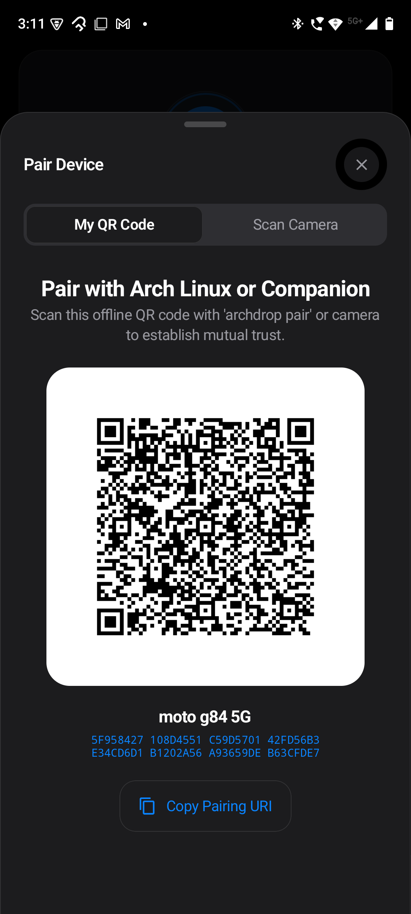

<div align="center">

# ⚡ Arch Drop

**Apple-grade continuity between Arch Linux (Hyprland) and Android.**  
*Instant P2P file drops • Universal clipboard • Continuity camera • Low-latency PipeWire audio*

[](https://www.rust-lang.org/)
[](https://developer.android.com/)
[](https://hyprland.org/)
[](#architecture)
[](LICENSE)

<br/>

**Zero cloud. Zero root. Zero bloat.**

</div>

---

## 📱 App Experience

<div align="center">

| **Drop Dashboard** | **Continuity Studio (Audio)** |
|:---:|:---:|
|  |  |

| **Continuity Camera (V4L2)** | **Device Pairing & Discovery** |
|:---:|:---:|
|  |  |

</div>

<p align="center">
  <sub>Captured on physical Android companion device running Material 3 + Cupertino-inspired UI.</sub>
</p>

---

## ✨ Highlights

- 🚀 **High-Speed AirDrop / LocalSend v2**: Direct peer-to-peer file and folder streaming powered by Hyper 1.11 with Ring mTLS certificate pinning and SHA-256 fingerprint verification.
- 📋 **Wayland Universal Clipboard**: Native `ext_data_control_manager_v1` integration. Adopts Apple's **4 KB rule** (inline $\le$ 4 KB, lazy stream $> 4$ KB), **120s ephemeral TTL**, auto-zeroization on screen lock (`systemd-logind`), and password-manager hint filtering.
- 📡 **Hardware-Safe Offline P2P**: BLE GATT discovery triggers Android Local-Only Hotspot (LOHS) in pure station mode. Eliminates Realtek Wi-Fi MCC driver panics while keeping existing WireGuard tunnels intact.
- 📷 **Continuity Camera**: Stream Android camera directly to Linux as a native V4L2 (`/dev/video*`) virtual webcam for OBS, Discord, and browsers.
- 🎧 **Continuity Audio**: Ultra-low-latency bidirectional PipeWire / PulseAudio sink and source streaming encoded via Opus.
- 🛡️ **Zero-Root Userspace Coexistence**: Android companion runs userspace SOCKS5/tsnet—coexisting peacefully with commercial VPNs without capturing `VpnService`.
- 📊 **Hyprland / Waybar Integration**: Real-time daemon status stream over JSON IPC for Waybar modules and Dunst notification toasts.

---

## 🏗️ Architecture

```
                       +-----------------------------------+
                       |      HEADSCALE CONTROL PLANE      |
                       | (Node Keys, STUN & DERP Fallback) |
                       +-----------------+-----------------+
                                         |
                +------------------------+------------------------+
                v (WireGuard / STUN Discovery)                     v
+-----------------------------------+     +-----------------------------------+
|     ARCH LINUX HOST (HYPRLAND)    |     |          ANDROID COMPANION        |
|                                   |     |                                   |
|   archdropd (Headless Daemon)     |     |   Arch Drop App (Jetpack Compose) |
|   ├── LocalSend Transfer Engine   |<===>|   ├── LocalSend Receiver Server   |
|   ├── Wayland Clipboard Watcher   |<===>|   ├── Clipboard & Notif Sync Svc  |
|   ├── V4L2 Camera Loopback Sink   |<===>|   ├── CameraStream Producer       |
|   ├── PipeWire Opus Audio Stream  |<===>|   ├── Opus Audio Sink / Source    |
|   └── BLE Central & NM Controller |<===>|   └── BLE GATT Server + LOHS AP   |
+-----------------------------------+     +-----------------------------------+
                ^                                         ^
                |===== Direct P2P 802.11ax Link (Fast Path) ======|
                |===== Encrypted DERP HTTPS Relay (Fallback) =====|
```

---

## 📦 Workspace Crates

| Crate | Description |
| :--- | :--- |
| [`crates/archdropd`](crates/archdropd) | Unified daemon CLI, systemd integration, Waybar IPC |
| [`crates/archdrop_core`](crates/archdrop_core) | Configuration, mTLS Ring crypto, cert generation & pinning |
| [`crates/archdrop_transfer`](crates/archdrop_transfer) | LocalSend v2 HTTP/1.1 transfer engine (Hyper 1.11) |
| [`crates/archdrop_clipboard`](crates/archdrop_clipboard) | Wayland data control watcher, 4KB threshold, lock zeroization |
| [`crates/archdrop_wireless`](crates/archdrop_wireless) | BLE GATT advertising, Apple 0x05/0x0D/0x0E frames, NetworkManager |
| [`crates/archdrop_mesh`](crates/archdrop_mesh) | Mesh networking, DERP frame framing, policy routing |
| [`crates/archdrop_webcam`](crates/archdrop_webcam) | V4L2 loopback virtual camera device feeder |
| [`crates/archdrop_audio`](crates/archdrop_audio) | PipeWire / PulseAudio low-latency Opus audio streaming |
| [`android/`](android) | Native Kotlin/Compose companion app (minSdk 29, targetSdk 35) |

---

## ⚡ Quickstart

### 1. Build & Install Daemon (Arch Linux)

```bash
# Clone the repository
git clone https://github.com/premkumar0184/Arch-Drop.git
cd Arch-Drop

# Build release binaries (< 15 MB RSS footprint)
cargo build --release

# Install systemd user service & Waybar module
./scripts/install-service.sh
```

### 2. Run Daemon Interactively

```bash
# Start foreground daemon
archdropd daemon

# Send a file via direct IP
archdropd send /path/to/file.png --to 192.168.1.100

# Discover peers and send over offline P2P (BLE + LOHS)
archdropd send /path/to/movie.mkv --p2p

# Stream Waybar status
archdropd status --stream
```

### 3. Build & Install Android Companion App

```bash
cd android
./gradlew assembleDebug
adb install -r app/build/outputs/apk/debug/app-debug.apk
```

---

## 🔒 Security & Privacy

- **mTLS by Default**: Every node generates an ephemeral or pinned X.509 certificate with RSA-2048 / Ring crypto.
- **Zero Cloud Relay**: Traffic flows directly over Wi-Fi LAN or local P2P hotspot; WAN transfers route via self-hosted Headscale / DERP.
- **Memory Zeroization**: Clipboard buffers are wiped immediately on session lock via `systemd-logind` D-Bus notifications.
- **Leak Prevention**: Passwords and secrets marked with `x-kde-passwordManagerHint` or `application/x-secret` are rejected at the protocol level.

---

## 📄 License

Licensed under the Apache License, Version 2.0.
