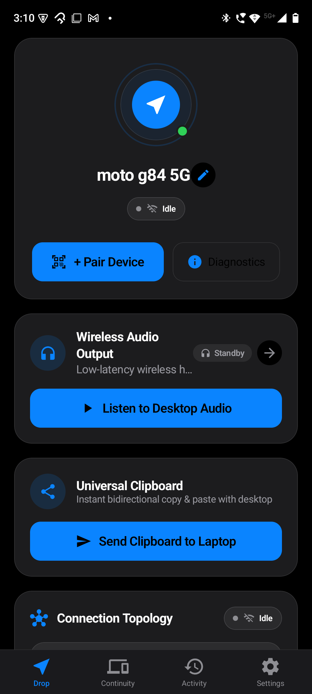
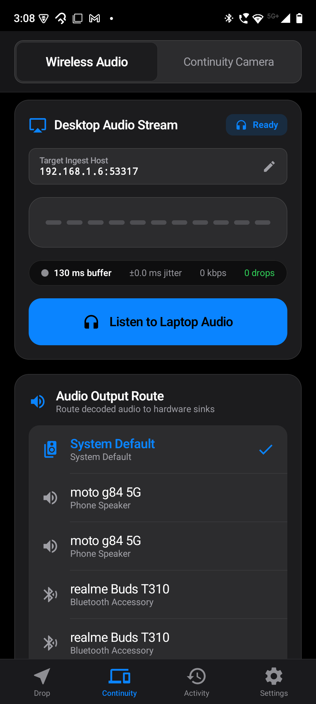
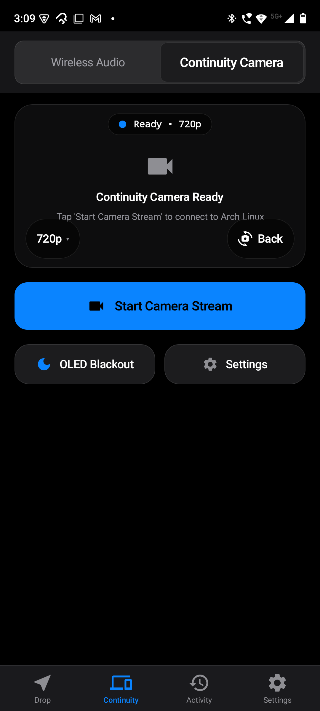

# Arch Drop

**Arch Drop** is an open-source personal device continuity engine connecting Arch Linux (Wayland / Hyprland) and Android devices. It delivers Apple Continuity-grade workflows—peer-to-peer file transfers, universal clipboard synchronization, virtual camera loopback (V4L2), and low-latency PipeWire audio streaming—with zero cloud dependencies and zero root requirements.

[](https://www.rust-lang.org/)
[](https://developer.android.com/)
[](https://hyprland.org/)
[](LICENSE)
[](#architecture--resource-budget)

---

## Overview

Arch Drop bridges the gap between modern Linux desktop environments and mobile devices without proprietary services or heavyweight desktop suites. Built around a headless Rust daemon (`archdropd`) and an Android companion application, the system operates across local Wi-Fi, offline hardware-safe P2P connections, and encrypted overlay networks.

### Key Capabilities

* **High-Throughput File Transfer**: Point-to-point file streaming over HTTP/1.1 (Hyper) using the LocalSend v2 wire protocol with mutual TLS (mTLS) certificate pinning.
* **Wayland Universal Clipboard**: Background clipboard synchronization via Wayland's `ext_data_control_manager_v1` protocol. Implements the 4 KB threshold rule (inlined payloads $\le 4\text{ KB}$, lazy streams $> 4\text{ KB}$), 120-second ephemeral expiration, and automatic memory zeroization upon session lock (`systemd-logind`).
* **Hardware-Safe Offline P2P**: BLE GATT discovery triggers Android Local-Only Hotspot (LOHS) in pure station mode. Eliminates Multi-Channel Concurrency (MCC) driver crashes common on Realtek wireless chipsets (e.g., RTL8852BE) while leaving host WireGuard tunnels intact.
* **Continuity Camera**: Low-latency video pipeline streaming the Android camera into a Linux V4L2 virtual loopback device (`/dev/video*`) for OBS, web browsers, and conferencing tools.
* **Continuity Audio**: Bidirectional audio sink and source integration using PipeWire and Opus encoding for wireless desktop audio monitoring.
* **Non-Invasive Android Integration**: Operates completely in user space without requiring root privileges or hijacking the system `VpnService`, allowing concurrent use of commercial VPNs.

---

## Interface Preview

<div align="center">

| **Drop Dashboard** | **Continuity Studio (Audio)** |
| :---: | :---: |
|  |  |

| **Continuity Camera (V4L2)** | **Device Pairing & Discovery** |
| :---: | :---: |
|  |  |

</div>

---

## Comparison with Existing Tools

| Feature | Arch Drop | KDE Connect | LocalSend | Quick Share / Warpinator |
| :--- | :---: | :---: | :---: | :---: |
| **Linux Architecture** | Headless Rust daemon (<15 MB RSS) | Qt/KDE Frameworks (~120 MB RSS) | Flutter desktop app (~150 MB RSS) | Python / GTK app (~80 MB RSS) |
| **Wayland Native Support** | Native `ext-data-control` (Hyprland / Sway) | Requires X11 or KWin/Plasma | Clipboard manual trigger | Variable / X11 dependent |
| **Continuity Camera (V4L2)** | Built-in | Plugin (experimental) | Not supported | Not supported |
| **PipeWire Low-Latency Audio** | Built-in (Opus sink/source) | Playback control only | Not supported | Not supported |
| **Offline P2P Hotspot Trigger** | BLE GATT $\rightarrow$ Android LOHS | Manual Wi-Fi hotspot | Manual Wi-Fi hotspot | Wi-Fi Direct (proprietary) |
| **Android VPN Coexistence** | Full (userspace networking) | Full (LAN only) | Full (LAN only) | Partial (conflicts with VPN) |
| **Security Architecture** | Ring mTLS + SHA-256 Cert Pinning | TLS with pairing key | Self-signed TLS | Proprietary / TLS |
| **Desktop Status Streaming** | Real-time JSON IPC (Waybar/Dunst) | Desktop widget | GUI only | System tray |

---

## System Requirements

### Host (Arch Linux)
* **OS**: Linux kernel 5.10+ (Arch Linux recommended)
* **Compositor**: Wayland compositor supporting `ext_data_control_manager_v1` or `zwlr_data_control_manager_v1` (Hyprland, Sway, River, etc.)
* **Audio**: PipeWire (with `pipewire-pulse` compatibility)
* **Video Loopback**: `v4l2loopback-dkms` (required for Continuity Camera)
* **Network & Bluetooth**: NetworkManager (`zbus` D-Bus integration) and BlueZ (`bluer` BLE integration)

### Mobile (Android)
* **OS**: Android 10 (API Level 29) through Android 15 (API Level 35)
* **Hardware**: Bluetooth Low Energy (BLE) peripheral mode support and Wi-Fi Direct / Local-Only Hotspot capability

---

## Workspace Layout

The repository is structured as a Cargo workspace with modular crates alongside the Android Gradle project:

```
.
├── Cargo.toml                       # Workspace manifest and shared dependencies
├── crates/
│   ├── archdropd/                   # Headless daemon, CLI entry point, and Waybar IPC
│   ├── archdrop_core/               # Core configuration, models, and mTLS Ring crypto
│   ├── archdrop_transfer/           # LocalSend v2 HTTP transfer engine (Hyper 1.11)
│   ├── archdrop_clipboard/          # Native Wayland clipboard watcher and TTL manager
│   ├── archdrop_wireless/           # BLE GATT controller and NetworkManager station driver
│   ├── archdrop_mesh/               # DERP framing, mesh synchronization, and routing
│   ├── archdrop_webcam/             # V4L2 virtual camera feed driver
│   └── archdrop_audio/              # PipeWire / PulseAudio Opus streaming engine
├── android/                         # Companion Android application (Kotlin / Jetpack Compose)
├── packaging/                       # Distribution packaging (Arch Linux PKGBUILD)
├── systemd/                         # Systemd user service unit files
├── scripts/                         # Service installation and management scripts
├── examples/                        # Integration configs (Waybar, status scripts)
└── tests/                           # End-to-end integration and adversarial stress test suites
```

---

## Installation

### Method 1: Arch Linux (PKGBUILD)

A packaging script is provided in `packaging/arch/`:

```bash
cd packaging/arch
makepkg -si
```

This compiles the release binary, places `archdropd` in `/usr/bin/`, installs the systemd unit to `/usr/lib/systemd/user/archdropd.service`, and configures documentation.

### Method 2: Build from Source (Cargo)

1. **Install Build Dependencies**:
   ```bash
   sudo pacman -S --needed base-devel rust bluez networkmanager wl-clipboard pipewire v4l2loopback-dkms
   ```

2. **Clone the Repository**:
   ```bash
   git clone https://github.com/premkumar0184/Arch-Drop.git
   cd Arch-Drop
   ```

3. **Compile Release Binaries**:
   ```bash
   cargo build --release
   ```

4. **Install Systemd User Service**:
   ```bash
   ./scripts/install-service.sh --user
   ```

### Method 3: Android Companion App

Compile and install the companion application using Gradle:

```bash
cd android
./gradlew assembleDebug
adb install -r app/build/outputs/apk/debug/app-debug.apk
```

---

## Quick Start & Usage

### 1. Managing the Background Daemon

Enable and start the user service:

```bash
systemctl --user enable --now archdropd
```

To run the daemon in the foreground for debugging:

```bash
archdropd daemon
```

### 2. Sending Files

Send files directly to a specific IP address on the local network:

```bash
archdropd send /path/to/document.pdf --to 192.168.1.100
```

Initiate an automated offline P2P transfer (wakes Android Local-Only Hotspot via BLE, associates station, and streams):

```bash
archdropd send /path/to/archive.tar.gz --p2p
```

### 3. Wayland Clipboard Operations

The clipboard synchronization runs automatically as part of `archdropd daemon`. To manually push current Wayland clipboard contents to paired devices:

```bash
archdropd clipboard send
```

### 4. IPC Status & Desktop Shell Integration

`archdropd` exposes an IPC socket providing real-time JSON status updates for status bars and notification daemons:

```bash
archdropd status --stream
```

Example JSON payload emitted by the IPC stream:

```json
{
  "state": "idle",
  "paired_devices": 1,
  "active_transfers": 0,
  "clipboard_synced": true,
  "audio_streaming": false,
  "webcam_streaming": false,
  "mesh_connected": true
}
```

#### Waybar Configuration Example

Add the custom module to `~/.config/waybar/config.jsonc`:

```jsonc
"custom/archdrop": {
    "format": "⚡ {}",
    "return-type": "json",
    "exec": "archdropd status --stream",
    "on-click": "archdropd send $(zenity --file-selection) --p2p",
    "tooltip": true
}
```

---

## Architecture & Resource Budget

```
                       +-----------------------------------+
                       |      HEADSCALE CONTROL PLANE      |
                       | (Node Keys, STUN & DERP Fallback) |
                       +-----------------+-----------------+
                                         |
                +------------------------+------------------------+
                v (WireGuard / STUN Discovery)                     v
+-----------------------------------+     +-----------------------------------+
|     ARCH LINUX HOST (HYPRLAND)    |     |          ANDROID COMPANION        |
|                                   |     |                                   |
|   archdropd (Headless Daemon)     |     |   Arch Drop App (Jetpack Compose) |
|   ├── LocalSend Transfer Engine   |<===>|   ├── LocalSend Receiver Server   |
|   ├── Wayland Clipboard Watcher   |<===>|   ├── Clipboard & Notif Sync Svc  |
|   ├── V4L2 Camera Loopback Sink   |<===>|   ├── CameraStream Producer       |
|   ├── PipeWire Opus Audio Stream  |<===>|   ├── Opus Audio Sink / Source    |
|   └── BLE Central & NM Controller |<===>|   └── BLE GATT Server + LOHS AP   |
+-----------------------------------+     +-----------------------------------+
                ^                                         ^
                |===== Direct P2P 802.11ax Link (Fast Path) ======|
                |===== Encrypted DERP HTTPS Relay (Fallback) =====|
```

* **Memory Usage**: The daemon maintains a steady-state footprint of `< 15 MB RSS` under idle conditions and `< 30 MB RSS` during multi-gigabyte transfers.
* **Zero Runtime Overhead**: When idle, the process consumes 0.0% CPU, listening purely on event-driven epoll / D-Bus signal sockets.
* **Pure Wayland**: Bypasses Xwayland entirely, eliminating legacy clipboard security vulnerabilities.

---

## Security Model

* **Mutual TLS (mTLS)**: All communication between Linux and Android endpoints is encrypted with TLS 1.3 using Ring cryptography and ephemeral or pinned X.509 certificates.
* **Certificate Pinning**: Nodes verify uppercase SHA-256 fingerprint hashes before establishing data channels, preventing man-in-the-middle attacks on untrusted networks.
* **Session Lock Zeroization**: Listens to `org.freedesktop.login1.Session.Lock` signals over system D-Bus. When the desktop locks, active clipboard memory buffers are scrubbed immediately.
* **Secret Protection**: Rejects clipboard offers carrying password hints (`x-kde-passwordManagerHint`, `application/x-secret`, `application/x-1password-sensitive`).

---

## Contributing

Contributions, bug reports, and suggestions are welcome.

1. **Verify Formatting & Lints**:
   ```bash
   cargo fmt --check
   cargo clippy --workspace --all-targets -- -D warnings
   ```

2. **Run Workspace Test Suites**:
   ```bash
   cargo test --workspace
   ```

3. **Run Android Companion Tests**:
   ```bash
   cd android
   ./gradlew testDebugUnitTest
   ```

When submitting pull requests, ensure new functionality includes corresponding unit or integration test coverage.

---

## License

This project is licensed under the [Apache License, Version 2.0](LICENSE).
